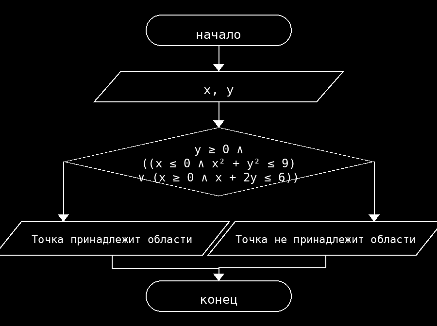

**Условие**
Определить, принадлежит ли точка с координатами (x, y) заданной области: y ≥ 0, и либо (x ≤ 0 и x² + y² ≤ 9), либо (x ≥ 0 и x + 2y ≤ 6).

**Блок схема**

**Контрольный пример**
Ввод: -2 1
Вывод: Точка принадлежит области

Ввод: 2 1
Вывод: Точка принадлежит области

Ввод: -3 0
Вывод: Точка принадлежит области

Ввод: -3 1
Вывод: Точка не принадлежит области

Ввод: 0 -1
Вывод: Точка не принадлежит области
